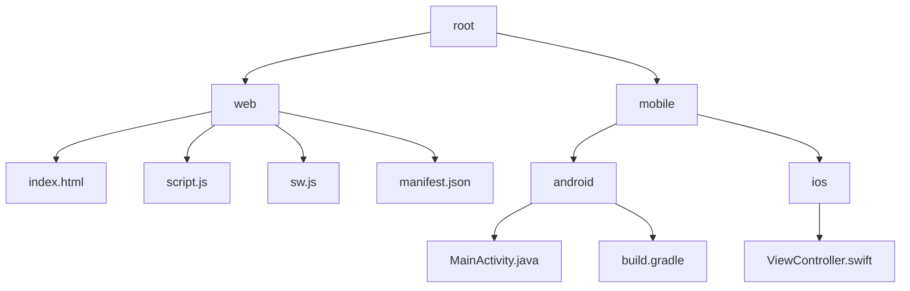
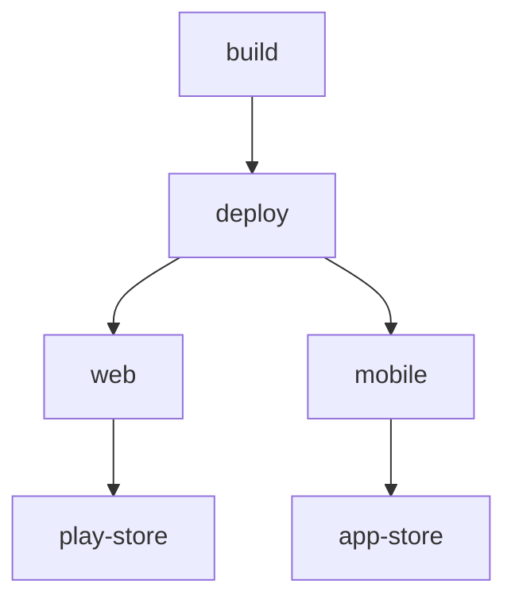

# Tic Tac Toe Web Game 🎮

## 🗂️  Description

The Tic Tac Toe Web Game is a simple, interactive game built for web and mobile platforms. This project allows users to play the classic Tic Tac Toe game against another player or against the computer. The game features a clean and intuitive interface, making it accessible to players of all ages.

The game is designed to be easily deployable on various platforms, including web, Android, and iOS, with a focus on providing a seamless user experience across different devices.

## ✨ Key Features

### Game Features
* Play against another player or against the computer
* Interactive game board with clear instructions
* Win conditions and draw detection
* Simple and intuitive interface

### Technical Features
* Built using modern web technologies (HTML, CSS, JavaScript)
* Supports Progressive Web App (PWA) functionality
* Integrates Google AdMob for monetization
* Compatible with Android and iOS devices

## 🗂️ Folder Structure

## 🛠️ Tech Stack

## ⚙️ Setup Instructions

To run the project locally, follow these steps:

* Clone the repository: `git clone https://github.com/ausafulislam/Tic-Tac-Toe-Web-Game.git`
* Navigate to the project directory: `cd Tic-Tac-Toe-Web-Game`
* Open the `index.html` file in a web browser to play the game

For Android and iOS development, you'll need to set up the respective development environments and import the project files.

## 📦 GitHub Actions

This project uses GitHub Actions for automated testing and deployment. The workflow is defined in the `.github/workflows/main.yml` file and includes steps for building and deploying the game to various platforms.

  

<h3>Ausaf ul Islam</h3>

Software Developer, Tech Explorer, and Problem Solver with a passion for growing in computer science.

 

  <a href="https://gitfull.vercel.app">Made by GitFull</a>

    